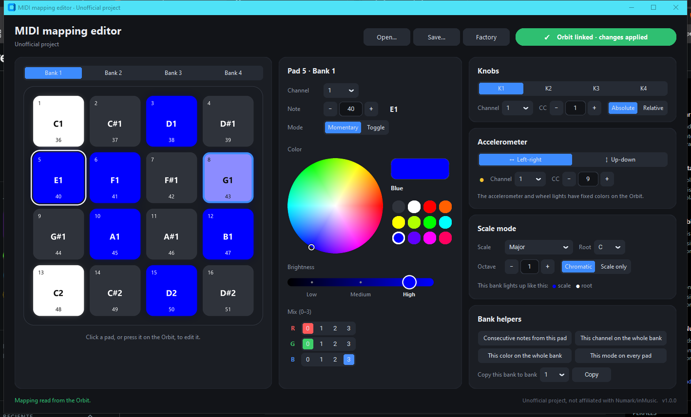
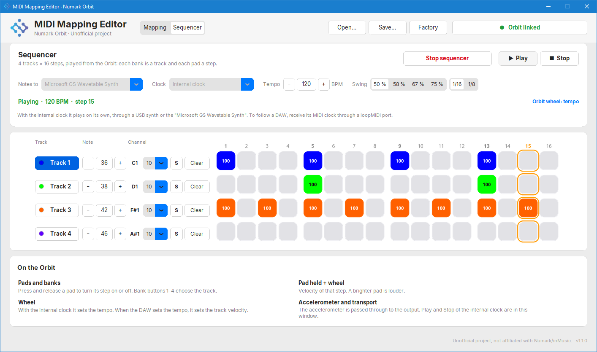

# Orbit Editor (Unofficial)

A Windows editor for the MIDI mapping of the **Numark Orbit** controller, written from scratch. It
changes the channel, note or CC, mode and color of every pad, plus the knobs and accelerometer of all
4 banks, and applies each change to the Orbit right away. It also turns the Orbit into a
**4-track step sequencer**.

> [!NOTE]
> This is an unofficial project, not affiliated with or endorsed by Numark or inMusic. It was built
> for interoperability, without copying any code or assets from the original editor.

**Mapping**, with scale mode on bank 4:



**Sequencer**, playing:



---

## Features

* **Automatic linking**: finds the Orbit as soon as it is plugged in, by cable or through its wireless
  receiver. No port to choose.
* **Live preview**: every change is stored in the Orbit half a second after your last edit, and the app
  reads it back to check that it was stored correctly.
* **Follows the Orbit**: press a pad on the Orbit and it lights up on screen, selected for editing. The
  app also follows the bank, the K buttons and the accelerometer.
* **Pads**: channel, note, momentary/toggle mode and color, with a color wheel, **3 brightness levels**,
  a 0–3 red·green·blue mix (64 colors) and 12 quick colors.
* **Knobs K1–K4**: channel, CC and absolute/relative mode.
* **Accelerometer**: channel and CC of each axis (left-right and up-down).
* **Scale mode**: 14 scales (major, modes, minors, blues, pentatonics, triads) with root and octave.
  The 16 pads can be chromatic (scale notes lit) or scale notes only. Each bank has its own scale and
  lights up in its own colors.
* **Helpers**: consecutive notes, same channel, color or mode on the whole bank, and bank copy.
* **Presets**: save and open `.json` (scales included) or `.syx` (the Orbit's own SysEx dump).
* **English and Spanish**, following your Windows language.

### Sequencer

Inspired by the sequencer of the nanoKONTROL 2 editor: **4 tracks × 16 steps**, where each bank of the
Orbit is a track and each pad a step. The pads light up live with the pattern: each track in its
color, brighter for louder steps, and the playhead moving across them.

| On the Orbit | What it does |
|---|---|
| Pad (press and release) | Turns that step on or off |
| Bank buttons 1–4 | Choose the track |
| Hold a pad + turn the wheel | Velocity of that step |
| Wheel | **Tempo** with the internal clock; when a DAW sends the clock (and so sets the tempo), the **velocity** of the track |
| K1–K4 | Turn track 1–4 on or off. The tracks start off when the sequencer starts, like the K LEDs (LED lit = playing) |
| Right shoulder + tilt forward/back | **Beat repeat**: repeats the current step, faster the more you tilt (1/16, 1/32, 1/48) |
| Left shoulder + tilt left/right | **Filter**: sends a CC (74, cutoff, by default; set it in the window) on the selected track's channel, to map in a DAW or synth |

> [!NOTE]
> The Orbit only reports a K button when you switch to a different K: pressing the same K twice toggles
> its LED but sends nothing the second time. To turn a track back on, go through another K, or use the
> **M** buttons in the window (they also bring the LEDs and the tracks back in step).

In the window: the note and MIDI channel of each track (drums on channel 10 by default), solo, clear,
swing (50–75 %, on 16ths or 8ths), tempo, and Play / Stop. Click a step to turn it on or off, and use
the mouse wheel over it to change its velocity.

* **Internal clock**: plays on its own through any MIDI output, e.g. a USB synth or the
  *Microsoft GS Wavetable Synth* built into Windows.
* **DAW clock**: follows your DAW's MIDI clock, Play, Stop and song position through a
  [loopMIDI](https://www.tobias-erichsen.de/software/loopmidi.html) port (free; the app links to it).

While the sequencer runs, the Orbit holds a sequencer mapping; your own mapping comes back as soon as
you stop it or close the app (and on the next start, if the app was closed unexpectedly).

## Requirements

* Windows 10 / 11
* A Numark Orbit connected by mini-USB cable or through its USB wireless receiver.
* For the sequencer with a DAW only: [loopMIDI](https://www.tobias-erichsen.de/software/loopmidi.html).

## How to use

1. Download `Orbit.Editor.exe` from the [Releases](../../releases) page.
2. Close your DJ software: while the editor is open, the Orbit stays linked to it, and Windows does not
   let another program use it at the same time.
3. Run the `.exe`. The status button turns to **Orbit linked** and the Orbit's current mapping is loaded.
4. Click a pad (or press it on the Orbit) and change anything. The Orbit updates by itself.
5. Use **Factory** to go back to the factory mapping, and **Save…** to keep your mapping in a file.

### Windows or the antivirus says the app is dangerous

The `.exe` is not digitally signed, so Windows SmartScreen shows "Unknown publisher". Click
**More info** → **Run anyway**.

A few antivirus engines flag apps made with PyInstaller as false positives. Every release `.exe` is
built by [GitHub Actions](../../actions) from the code in this repository, and each release includes a
`SHA256.txt` so you can check your download:

```powershell
Get-FileHash "Orbit.Editor.exe" -Algorithm SHA256
```

## Orbit limitations

* The accelerometer, wheel and K button LEDs have fixed colors in the firmware. Only pads can be colored.
* The active bank and K can only be changed on the Orbit itself; the firmware ignores such requests
  from the PC. The app follows the bank and K you choose on the Orbit.
* The Orbit has no Bluetooth: its wireless link is a 2.4 GHz radio that only works with its USB
  receiver. See [research/WIRELESS.md](research/WIRELESS.md).

---

## Technical documentation

* [research/PROTOCOL.md](research/PROTOCOL.md): the Orbit's SysEx protocol (read, write and the
  240-byte layout), with everything confirmed on a real Orbit.
* [research/ARCHITECTURE.md](research/ARCHITECTURE.md): code structure, safety rules and history.
* [research/WIRELESS.md](research/WIRELESS.md): wireless connection options.

## License

MIT — see [LICENSE](LICENSE).
