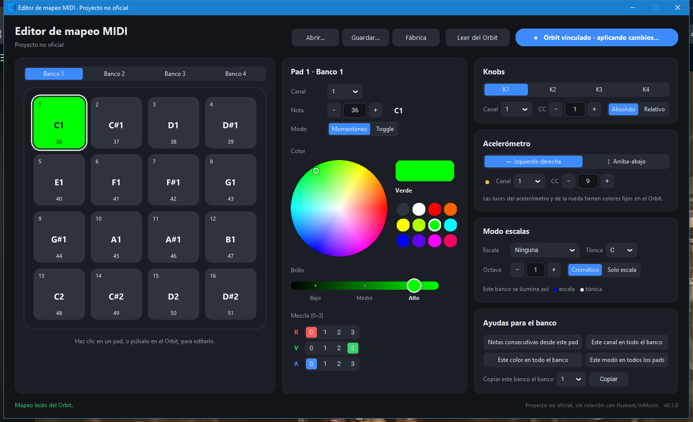

# Orbit Editor (no oficial) · Numark Orbit MIDI mapping editor

Editor para Windows del mapeo MIDI del controlador **Numark Orbit**, hecho desde cero: cambia el canal,
la nota o el CC, el modo y el color de cada pad, los knobs y el acelerómetro de los 4 bancos, y lo
aplica al Orbit al instante.

> [!NOTE]
> Proyecto no oficial, sin relación con Numark ni inMusic. Se ha creado por interoperabilidad, sin
> copiar código ni recursos del editor original. *Unofficial project, not affiliated with or endorsed
> by Numark or inMusic.*



---

## Funciones

* **Vinculación automática**: detecta el Orbit en cuanto lo conectas, por cable o con su receptor
  inalámbrico. No hay que elegir ningún puerto.
* **Vista previa en vivo**: cada cambio se guarda en el Orbit medio segundo después de la última
  edición, y la app comprueba que se ha guardado bien releyéndolo.
* **El Orbit manda**: al pulsar un pad en el Orbit, se ilumina en pantalla y queda seleccionado para
  editarlo. La app también sigue el banco, los botones K y el acelerómetro.
* **Pads**: canal, nota, modo momentáneo/toggle y color, con una rueda de color, **3 niveles de
  brillo**, una mezcla rojo·verde·azul de 0 a 3 (64 colores) y 12 colores rápidos.
* **Knobs K1–K4**: canal, CC y modo absoluto/relativo.
* **Acelerómetro**: canal y CC de cada eje (izquierda-derecha y arriba-abajo).
* **Modo escalas**: 14 escalas (mayor, modos, menores, blues, pentatónicas, tríadas), con tónica y
  octava. Los 16 pads pueden ser cromáticos (se encienden las notas de la escala) o solo notas de la
  escala. Cada banco tiene su escala y se ilumina con sus propios colores.
* **Ayudas**: notas consecutivas, mismo canal, color o modo en todo el banco, y copiar un banco.
* **Presets**: guarda y abre `.json` (incluye las escalas) o `.syx` (volcado SysEx del Orbit).
* **Español e inglés**, según el idioma de Windows.

## Requisitos

* Windows 10 / 11
* Numark Orbit conectado por cable mini-USB o con su receptor inalámbrico USB.

## Cómo usarlo

1. Descarga `Orbit Editor.exe` desde [Releases](../../releases).
2. Cierra tu software de DJ: mientras el editor está abierto, el Orbit queda vinculado a él y Windows
   no deja que otro programa lo use a la vez.
3. Abre `Orbit Editor.exe`. El botón de estado pasa a **Orbit vinculado** y se carga el mapeo actual
   del Orbit.
4. Haz clic en un pad (o púlsalo en el Orbit) y cambia lo que quieras. El Orbit se actualiza solo.
5. Para volver a la configuración original usa **Fábrica**. Para guardar tu mapeo en un archivo usa
   **Guardar…**.

### Windows o el antivirus dicen que la app es peligrosa

El `.exe` no tiene firma digital, así que Windows SmartScreen muestra "Editor desconocido". Pulsa
**Más información** → **Ejecutar de todas formas**.

Algunos antivirus marcan como falso positivo las apps hechas con PyInstaller. Cada `.exe` de las
releases lo compila [GitHub Actions](../../actions) a partir del código de este repositorio, e
incluye un `SHA256.txt` para comprobar la descarga:

```powershell
Get-FileHash "Orbit Editor.exe" -Algorithm SHA256
```

## Límites del Orbit

* Los LEDs del acelerómetro, de la rueda y de los botones K tienen colores fijos en el firmware. Solo
  se pueden colorear los pads.
* El banco y el K activos solo se pueden cambiar desde el propio Orbit; el firmware no acepta que el
  PC los cambie. La app sigue el banco y el K que elijas en el Orbit.
* El Orbit no tiene Bluetooth: su conexión inalámbrica es una radio de 2,4 GHz que solo funciona con
  su receptor USB. Ver [research/INALAMBRICO.md](research/INALAMBRICO.md).

---

## Documentación técnica

* [research/PROTOCOLO.md](research/PROTOCOLO.md): protocolo SysEx del Orbit (lectura, escritura y
  formato de los 240 bytes), con lo que se ha confirmado en un Orbit real.
* [research/PLAN.md](research/PLAN.md): arquitectura y plan por fases.
* [research/INALAMBRICO.md](research/INALAMBRICO.md): opciones de conexión inalámbrica.

Resumen del protocolo:

| Mensaje | Bytes |
|---|---|
| Pedir el mapeo | `F0 00 01 3F 2B 01 00 00 F7` |
| Respuesta del Orbit | `F0 00 01 3F 2B 02 01 70` + 240 bytes + `F7` |
| Escribir el mapeo | `F0 00 01 3F 2B 03 01 70` + 240 bytes + `F7` |

Los 240 bytes son 64 pads × (modo·canal, nota, color), 16 knobs × (modo·canal, CC) y 8 ejes ×
(canal, CC). El color usa 2 bits por componente: `R×16 + G×4 + B`.

## Desarrollo

```bash
python -m pip install -r requirements.txt
python -m unittest discover -s tests
python -m orbit_editor              # abre la ventana
python -m orbit_editor leer         # herramienta de consola (leer, copia, ver, convertir, escribir)
```

Los tests no necesitan el Orbit: usan un Orbit y un `winmm` simulados.

| Módulo | Qué hace |
|---|---|
| `orbit_editor/protocol.py` | Modelo de datos y codificación de los mensajes SysEx |
| `orbit_editor/colors.py` | Colores, brillo y paleta |
| `orbit_editor/scales.py` | Modo escalas |
| `orbit_editor/presets.py` | Archivos `.json` y `.syx` |
| `orbit_editor/midi_win.py` | MIDI de Windows (`winmm.dll` vía `ctypes`) |
| `orbit_editor/device.py` | Leer y escribir el mapeo, con verificación |
| `orbit_editor/link.py` | Vinculación automática y envío en vivo |
| `orbit_editor/render.py` | Dibujos suavizados con Pillow |
| `orbit_editor/gui.py` | Ventana (CustomTkinter) |
| `orbit_editor/cli.py` | Herramienta de consola |

## Licencia

[MIT](LICENSE)
